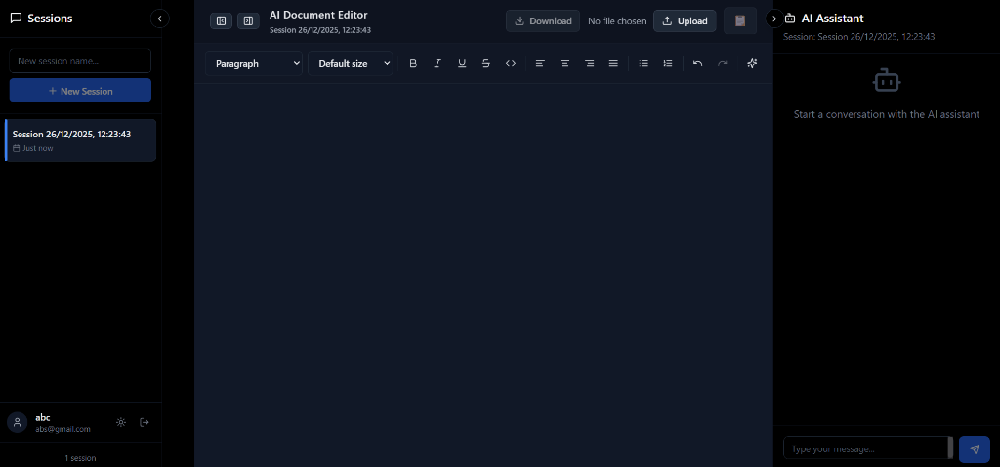

# 🤖 AI Document Editor

An AI-powered document editor: a Word-style editor with an AI assistant that writes and edits documents, answers questions about uploaded files (RAG), and lets every user bring their own model API key.



---

## ✨ Features

- 📝 **Word-style Home ribbon**: clipboard and Format Painter; fonts, sizes, grow/shrink, change case, sub/superscript, highlight and font color; bullets, numbering styles, indent, sort, line spacing, shading, paragraph marks; style gallery; Find & Replace; select sentence/paragraph; dictation; spell check
- 🤖 **AI chat that streams** its answers; questions are answered in the chat, edit requests come back as **suggested changes you accept or reject** paragraph by paragraph (unchanged text keeps its formatting; one undo reverts)
- ⚡ **Inline AI**: type `/` for AI commands (continue writing, improve, fix grammar, shorter/longer, formal, `/translate hindi`, `/table …`, `/ask …`) and quick blocks; optional **autocomplete** ghost text (Tab to accept)
- 🧭 **Studio**: pick a profession and its team of specialist agents writes the whole document. A lead editor plans it, specialists draft each section, reviewers check it, and flagged sections are revised. Professions: legal, medical, reports, research, news, articles and features, social media, film and TV, YouTube, reels and shorts, and courses (11 playbooks, 66 specialists and reviewers)
- 🔍 **Search across all your documents** (RAG on pgvector) with clickable cited sources; falls back to keyword ranking when no embedding model is reachable
- 📚 **Deep read** for long documents: instead of a few retrieved snippets, the model explores the whole text with code in a sandbox and hands pieces to helper models (recursive language model reading), for summaries, "list every…" questions and comparisons. The answer shows the code it ran
- 📄 **Upload** PDF (with OCR for scans), DOCX and TXT · 📤 **Export** to DOCX
- 🔑 **Bring your own key**: OpenAI, Anthropic, Gemini, Groq, Mistral, DeepSeek, OpenRouter, xAI, Together, or any OpenAI-compatible API
- 💳 **Paywall**: editing is free; AI uses your own key, the free daily allowance, or Pro
- 👤 Accounts, per-user sessions, autosave, dark mode

---

## 🚀 Run locally (Windows)

You need **Python 3.10+**, **Node.js 18+**, **Docker Desktop**, and **[Ollama](https://ollama.ai/download)** for the free local model.

```bash
ollama pull gemma3:latest
ollama pull nomic-embed-text:latest
```

Then start everything (open **http://localhost:3000** and register an account):

```bash
docker compose up -d                          # Postgres (pgvector) + Redis
cd backend && npm install && npm run db:deploy   # build/migrate tables with Prisma
python main.py                                 # API on http://localhost:8000 (docs at /docs)
cd ../frontend && npm install && npm run dev   # app on http://localhost:3000
```

Coming from the old SQLite version? Copy your users, sessions and messages over once:

```bash
cd backend && python scripts/import_sqlite.py data/sessions.db
```

---

## 🖥️ Desktop app (Windows installer)

`desktop/` wraps the website in a small Electron app so people can install it like any Windows program. It opens your
deployed site in its own window, so app updates reach desktop users as soon as you deploy, with no new installer.
Editing works for everyone who signs in; AI uses the same free daily allowance, own API key or Pro as the website.

1. Put your deployed site's address in `desktop/app.config.json` (use the `https://` address).
2. `cd desktop && npm install && npm run dist`
3. The installer and a portable `.exe` appear in `desktop/release/`.

To try it against your local dev server first: `cd desktop && npm start` (it opens `http://localhost:3000`). Run it from
a normal terminal: VS Code's terminal sets `ELECTRON_RUN_AS_NODE`, which makes Electron start as plain Node.js.

GitHub can build it for you: set the repository variable `APP_URL` (Settings → Secrets and variables → Actions →
Variables), then push a tag like `v1.0.0`. `.github/workflows/desktop.yml` builds the installer and attaches it to a
GitHub Release. The installer is unsigned, so Windows shows an "unknown publisher" warning until you add a code-signing
certificate. The window is locked down: the page has no access to the computer, other sites open in the normal browser,
and only your site may use the microphone and clipboard.

## 🌍 Deploying online

| Piece | Suggested service | Notes |
|-------|-------------------|-------|
| API (agents) | Google Cloud Run, Fly.io or Render | `backend/Dockerfile`; scales to zero when idle |
| Database | Neon (or Supabase) Postgres | `DATABASE_URL` = pooled string, `DIRECT_URL` = direct string (for migrations) |
| Redis | Upstash | rate limits and caches; optional |
| Frontend | Cloudflare Pages, Vercel or Netlify | `npm run build`, serve `frontend/dist` |

1. Build the API image from the repo root: `docker build -f backend/Dockerfile .`
2. Set the environment variables below as secrets on the API service.
3. Apply migrations from your machine or CI: `cd backend && DATABASE_URL=... npm run db:deploy`
4. Build the frontend with `VITE_API_URL=https://your-api.example.com` and set `CORS_ORIGINS` on the API to the frontend's URL.
5. Set `TRUSTED_PROXY_HOPS=1` on Cloud Run, Render or Fly so login rate limits see each visitor's real address.

---

## ⚙️ Configuration

Copy `backend/.env.example` to `backend/.env`. The important variables:

| Variable | Purpose |
|----------|---------|
| `SECRET_KEY` | Signs login tokens. Generate with `python backend/scripts/generate_secret_key.py` |
| `ENCRYPTION_KEY` | Encrypts users' saved API keys (set it in production) |
| `DATABASE_URL` / `REDIS_URL` | Postgres and Redis connections |
| `LLM_PROVIDER`, `LLM_MODEL`, `LLM_BASE_URL`, `LLM_API_KEY` | The server's own model (default: local Ollama) |
| `EMBEDDING_*` | Embedding model for document search |
| `FREE_AI_DAILY_LIMIT` / `PRO_AI_DAILY_LIMIT` | AI requests per day on the server model |
| `CORS_ORIGINS` | Frontend URLs allowed to call the API |
| `TRUSTED_PROXY_HOPS` | Proxies in front of the API (1 on Cloud Run, Render, Fly; 0 locally) |

Locally, `model-config.json` still sets the default Ollama model names.

### Paywall and API keys

- Editing, upload and export are free for everyone.
- AI requests run on the user's **own API key** when they've added one under **AI & Plan** (no limit), otherwise on the server model within the plan's daily limit (free: 10, Pro: 500 by default). Each report section counts as one request.
- Autocomplete fires while you type, so it needs the user's own key or Pro.
- Grant Pro by hand until a payment provider is connected: `python backend/scripts/set_plan.py user@example.com pro 30`

### Deep read (recursive reading)

Chat has two modes. **Quick** answers from the most relevant passages (RAG) plus the start of the document: one AI request.
**Deep read** (`backend/src/agents/rlm/`) gives the model the whole text as a variable in a sandbox. It writes code to look
around (`grep`, slices, `chunks`), sends pieces to helper models with `llm_query` / `llm_query_batch`, and replies with
`FINAL(answer)`. Texts under about 24,000 characters skip the loop and are read in one pass. Each model call after the first
counts as one AI request (at most 8 steps and 24 helper reads per question), free with the user's own key.

The sandbox (`sandbox.py`) never calls `exec` or `eval`: it parses the code, checks every node against an allow-list, and
interprets it itself. No imports, no `def`/`lambda`/`class`, no underscore names, methods only on plain strings, lists and
dicts; steps, value sizes, output, compute time (5 s per step) and helper calls are capped, and it yields to other requests
while it runs. `tests/test_rlm.py` tries the known escapes and resource attacks against it.

### Studio playbooks

Each profession is one file in `backend/src/agents/harness/playbooks/`: its document types, the questions its brief asks,
its specialists (each with a method), its reviewers (each with checks), its style and its safety rules. The harness in
`engine.py` runs any playbook the same way, so adding a profession means adding one file and listing it in
`playbooks/__init__.py`. A quick run costs one AI request per section plus the plan; "draft, review and revise" adds one per
reviewer and one per revised section.

### Tests

```bash
cd backend && python -m unittest discover -s tests -t .
```

They need no database or model server, and cover the security fixes (DOCX export cannot read server files or internal
URLs, upload size limits, custom provider URLs, the rate-limit client address), the harness's parsing and playbooks, and
the deep-read sandbox (escape attempts, resource limits) and reading loop.

### Database changes

Tables are defined in `backend/prisma/schema.prisma`. After editing it run `npm run db:migrate` in `backend/` to create a migration, and update the matching queries in `backend/src/db/`.

---

## 📁 Project structure

```
backend/
  main.py                 app startup and routes
  prisma/                 schema.prisma + migrations (tables are built by Prisma)
  src/
    config.py             settings from environment variables
    deps.py               login, per-request model choice, rate limits
    cache.py              Redis (or in-memory) cache and rate limiter
    db/                   one file of SQL queries per table (asyncpg)
    routes/               auth, chat, documents, sessions, keys, billing, health
    services/             chat pipeline (streaming), inline AI, LLM client, retrieval, citations, billing, keys
    services/documents/   parsing, OCR, upload ingest, DOCX export
    agents/harness/       the agent harness (engine, prompts, house style) and one playbook per profession
    agents/rlm/           deep read: the code sandbox, the recursive reading loop and its prompts
    agents/prompts.py     prompts for chat and inline AI
    text/                 markdown, placeholder, intent and safety helpers
  scripts/                import_sqlite, set_plan, generate_secret_key
  tests/                  unit tests (python -m unittest discover -s tests -t .)
frontend/src/
  components/ribbon/      the Home ribbon and Find & Replace
  components/             review panel, inline AI card, "/" menu, chat
  components/studio/      Studio: profession picker, brief, the crew line and review notes
  extensions/             TipTap extensions (paragraph format, search, "/" commands, autocomplete)
  editor/                 editor commands, AI change review, Format Painter, dictation
  services/http.ts        API calls with login and paywall handling
docker-compose.yml        local Postgres + Redis
```

---

## 🔧 Troubleshooting

| Issue | Solution |
|-------|----------|
| Database won't start | Start Docker Desktop, then run `docker compose up -d` again |
| AI says the service is unavailable | Run `ollama serve`, and `ollama pull gemma3:latest` |
| Document search finds nothing | Run `ollama pull nomic-embed-text:latest` |
| 402 / "used all AI requests" | Add your own API key under **AI & Plan**, or raise `FREE_AI_DAILY_LIMIT` |
| Port 3000/8000 in use | Change `server.port` in `frontend/vite.config.ts` / `PORT` in `backend/.env` |

---

## 🙏 Tech stack

React + TypeScript + Vite + TipTap · FastAPI + LangGraph · Postgres + pgvector (Prisma migrations, asyncpg) · Redis · Ollama or any OpenAI-compatible API · Tesseract OCR · pandoc
